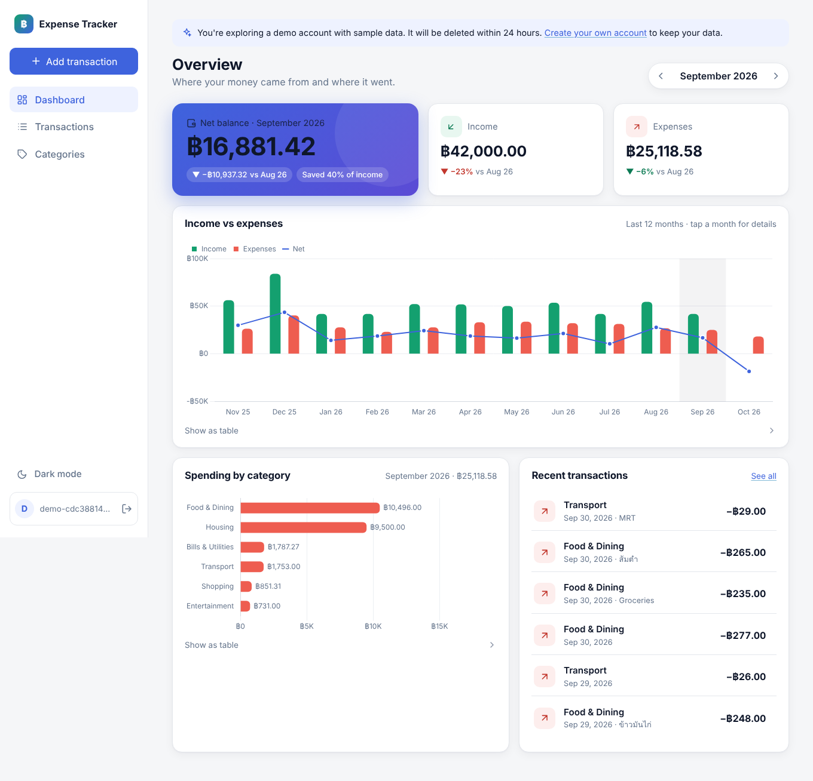
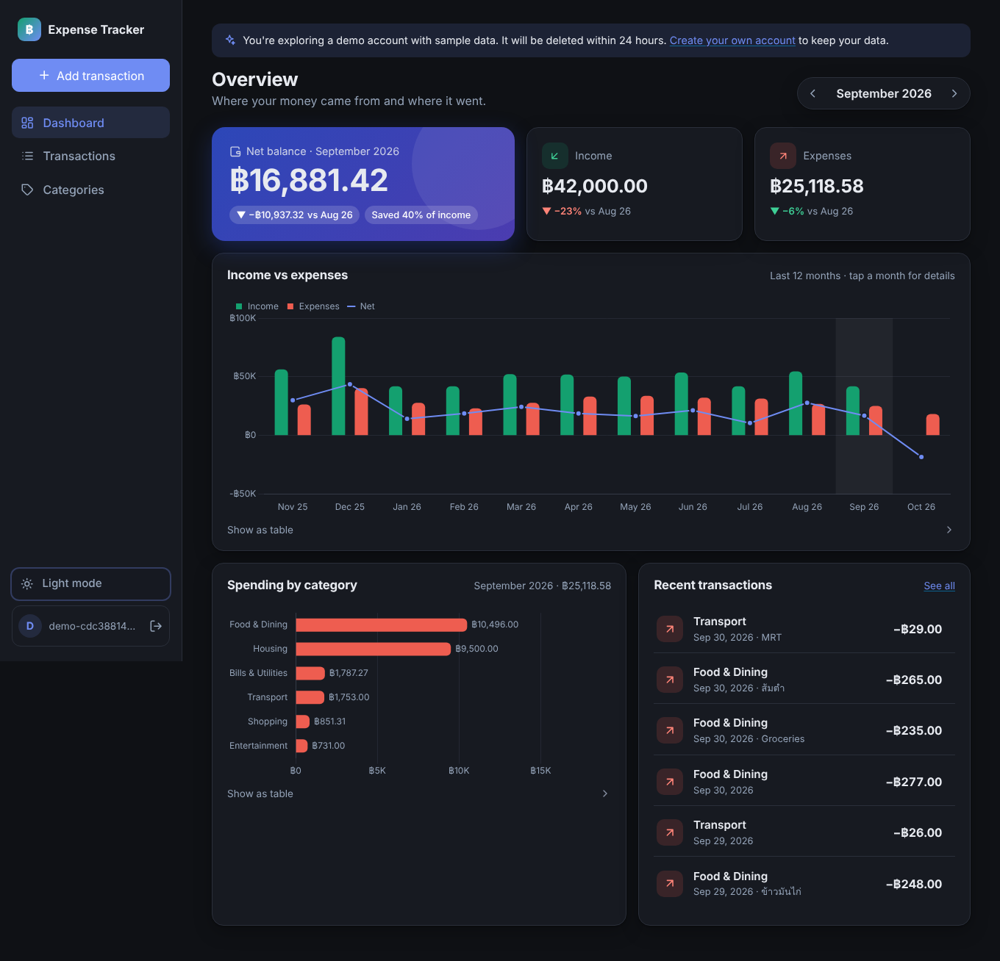
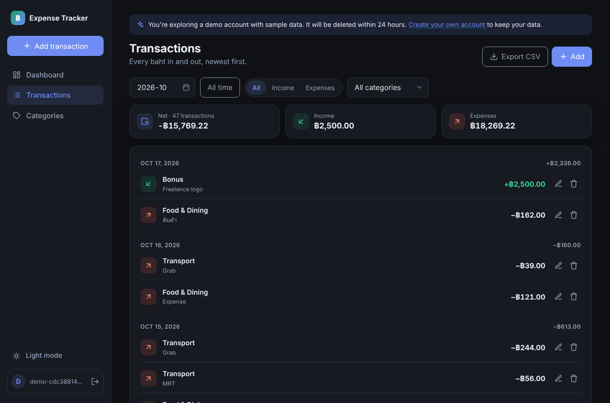
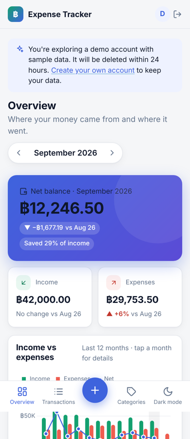

# Expense Tracker

[](https://github.com/PhiraponIntasit/expense-tracker-fastapi/actions/workflows/ci.yml)

A multi-user income and expense tracker with a monthly summary dashboard.
It is built with **FastAPI**, **PostgreSQL** and **SQLAlchemy 2.0**: a typed,
tested JSON API with a lightweight server-rendered UI on top.

**Live demo:** <https://expense-tracker-71yc.onrender.com>. Click **Try the demo** to get a
private account with a year of sample data, no sign-up needed. The free host
sleeps when idle, so the first load can take about a minute.



<table>
  <tr>
    <td></td>
    <td></td>
    <td width="22%"></td>
  </tr>
</table>

## Features

- **Dashboard:** income, expenses and net for the month compared with the
  month before; a 12-month income vs expenses chart (click a month to drill
  in); and a breakdown of expenses by category. Every chart has a table view.
- **Transactions:** add, edit and delete; filter by month, type and
  category; pagination with totals across all pages; CSV export that opens
  correctly in Excel, Thai text included.
- **Categories:** each user gets a starter set they can rename, add to and
  remove. A category that still has transactions can't be deleted.
- **Accounts:** email and password sign-up, plus a one-click demo account
  that deletes itself after 24 hours.
- **Quick entry anywhere:** an "Add transaction" dialog (or the **+** button
  on phones) on every page, with an Expense/Income switch and a large amount
  field.
- **Fits the device:** a sidebar on desktop and a bottom tab bar on phones;
  light and dark themes with a toggle that remembers your choice (it follows
  the system setting until you pick one).

## Technical highlights

- **Data isolation is tested.** Every endpoint is scoped to the current user,
  and other users' rows return `404` rather than `403`. The database enforces
  it too: a composite foreign key `(category_id, user_id)` makes it impossible
  to attach a transaction to someone else's category.
- **Money is exact.** Amounts are stored as `numeric(12,2)` and travel through
  the API as decimal strings (`"1234.50"`), never floats.
- **Summaries run in SQL.** Monthly totals use `date_trunc` and are joined to
  `generate_series`, so empty months come back as zeros and charts have no
  gaps. Tests cover month and year boundaries, exact decimals and the
  database time zone.
- **One token, two transports.** The same JWT works as an `httpOnly`,
  `SameSite=Lax` cookie for the browser and as a `Bearer` header for API
  clients (try **Authorize** in `/docs`).
- **Defence in depth.** Passwords are hashed with Argon2, and unknown emails
  take as long to reject as wrong passwords, so login timing doesn't reveal
  which accounts exist. Pages run under a strict CSP with no inline scripts,
  and cross-origin writes are rejected by `Origin`. CSV exports are guarded
  against formula injection. Production refuses to start with a default
  secret or insecure cookies.
- **Accessible charts.** Chart colours were checked for colour-vision
  deficiency and contrast in both themes, and each chart has a data table.
- **Production-shaped.** Alembic migrations (with `alembic check` in CI), a
  non-root Docker image, a health check, and a Render Blueprint.

The full reasoning behind each decision is in [docs/DESIGN.md](docs/DESIGN.md).

## Tech stack

| Layer | Choice |
|---|---|
| API | FastAPI, Pydantic v2 |
| Database | PostgreSQL 16, SQLAlchemy 2.0 (typed, sync), Alembic |
| Auth | PyJWT (HS256), pwdlib (Argon2) |
| UI | Jinja2, Pico.css, Chart.js, plain ES modules (no build step) |
| Quality | pytest against real Postgres, ruff, mypy `--strict`, GitHub Actions |
| Deploy | Docker, Render (app), Neon (Postgres) |

## API

Interactive docs are at `/docs`. Main endpoints:

```
POST   /api/auth/register | /token | /logout | /demo
GET    /api/users/me
GET    /api/categories              POST /api/categories
PATCH  /api/categories/{id}         DELETE /api/categories/{id}
GET    /api/transactions            ?month=YYYY-MM&type=&category_id=&limit=&offset=
POST   /api/transactions            GET | PATCH | DELETE /api/transactions/{id}
GET    /api/transactions/export.csv
GET    /api/summary/monthly         ?from=YYYY-MM&to=YYYY-MM
GET    /api/summary/by-category     ?month=YYYY-MM&type=expense
```

## Run it locally

With Docker only:

```bash
docker compose up --build
```

Then open <http://localhost:8000> and click **Try the demo**, or create an
account.

For development you need [uv](https://docs.astral.sh/uv/) and Docker (for
Postgres):

```bash
make db      # start Postgres on localhost:5432
make dev     # apply migrations and run with auto-reload
make seed    # create demo@example.com / demo-password with a year of sample data
make test    # run the test suite (creates the expense_test database if needed)
make lint    # ruff + mypy
```

Copy `.env.example` to `.env` to override settings.

## Deploy (Render + Neon, free tiers)

Render's free Postgres is deleted after 30 days, so the database lives on
Neon, whose free plan doesn't expire.

1. **Database:** create a project on [Neon](https://neon.com) in the
   Singapore region. Copy the **direct** (not pooled) connection string.
   Its `postgresql://…?sslmode=require` form works as is.
2. **App:** on [Render](https://render.com), choose **New → Blueprint**,
   connect this repository, and paste the Neon connection string as
   `DATABASE_URL` when asked. [`render.yaml`](render.yaml) sets up the rest:
   a Docker web service in Singapore, production mode, secure cookies, a
   generated `SECRET_KEY`, and the `/healthz` health check.
3. **Done:** migrations run automatically on every start. Each push to the
   default branch redeploys.

Free tier limits to expect: the app sleeps after 15 minutes without traffic
and takes about a minute to wake, and Neon allows 0.5 GB of storage. Demo
accounts are capped at 500 at a time, which stays well within that.

## Project layout

```
app/
  api/            JSON API routers (auth, users, categories, transactions, summary)
  templates/      Jinja2 pages        static/   CSS, ES modules, vendored libraries
  models.py       SQLAlchemy models   schemas.py  Pydantic request/response models
  accounts.py     register/login shared by the API and the pages
  demo.py         demo accounts       sample_data.py  realistic data generator
  web.py          server-rendered pages, CSP headers
alembic/          migrations
tests/            integration tests against real Postgres (rolled back per test)
docs/DESIGN.md    design decisions
```

## License

[MIT](LICENSE)
